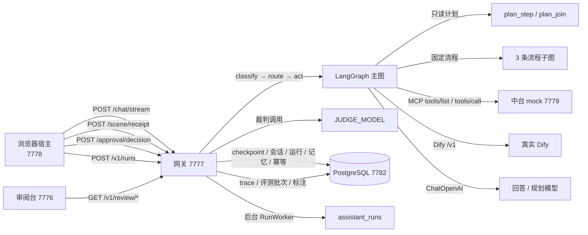
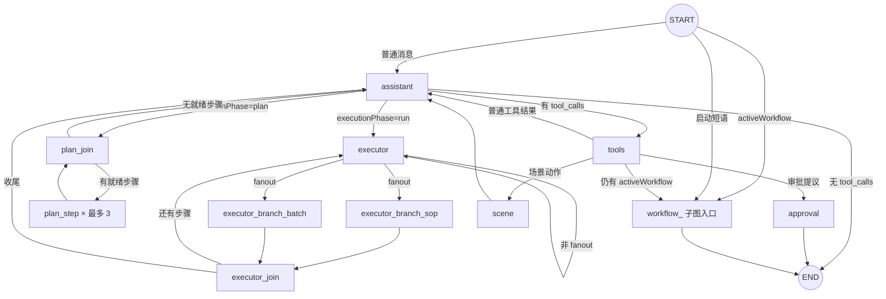

# 江中智能助手 · 项目全景与架构
> 面向制药车间数字孪生场景的对话式业务助手：自然语言查数据、走流程、发起人工确认，三维动作交给宿主执行，执行过程和交付结果都能被审阅。

## 一句话定位

江中智能助手是一个**面向制药车间数字孪生场景的对话式业务助手**：用户在浏览器里用自然语言提问或下指令，网关先判断意图、规划任务，再查中台、走固定业务流程、发起人工确认，并把三维动作交给宿主场景执行；执行过程和最终交付都能在审阅台被人工复核。

它不是通用聊天机器人，重点在五件事：

1. **业务可办理**：批次追溯、维修工单、巡检三条固定流程能一步步走完。
2. **查询有计划**：普通只读请求先产出结构化计划，再按依赖分批执行，最多 8 步、3 层依赖。
3. **三维可验证**：场景方法是否真正改变 ThingJS 画面，有执行记录可查。
4. **写操作可控**：告警取消、工单创建、巡检报修、备件申请、批次记录必须人工确认。
5. **质量可复核**：执行断言、逐题交付判定、人工标注、归因校准和回归草稿形成闭环。

## 系统架构图

<ZoomableFigure
  src="/assets/jiangzhong/architecture.svg"
  alt="江中智能助手系统架构、智能体运行流程与 LangGraph 主图"
  caption="系统架构、智能体运行流程与 LangGraph 主图；用上方按钮放大，或打开原图。"
/>

读图顺序：先看系统架构，再看 `classify → route → act` 的运行流程，最后看 LangGraph 主图与三个固定流程子图。逐层解释见[请求链路与 LangGraph](/03-项目实战/02-江中智能助手/02-请求链路与LangGraph)。

## 技术栈

| 层 | 选型 |
| --- | --- |
| 运行时 | Node.js 22、ESM、TypeScript 5.8 |
| HTTP | Express 5、zod 校验、SSE |
| Agent | `@langchain/core` 1.4、`@langchain/langgraph` 1.7、`@langchain/langgraph-checkpoint-postgres` 1.1、`@langchain/openai` 1.8 |
| 持久化 | PostgreSQL 15（会话、checkpoint、幂等、后台运行、长期记忆、审阅、标注） |
| 宿主对话模块 | TypeScript，浏览器 `fetch` + `ReadableStream`；位于 `examples/host-demo/src/assistant/`，不单独发布 |
| 演示宿主 | Vue 3.5、Element Plus、Vite 6、ThingJS 2.0 |
| 审阅台 | Vue 3.5、Element Plus、Vite 6 |
| 中台 | 本地 MCP mock（SQLite） |
| 交付 | esbuild 单文件服务端、Docker / compose |

## 仓库拓扑（当前）

```text
apps/
  server/                 # 网关：HTTP、LangGraph、Postgres、审阅、评测
  review/                 # 审阅台：链路、评测、标注、校准（7776）
examples/
  host-demo/              # ThingJS 全屏宿主 + 可移植对话模块（7778）
  mock-zhongtai/          # 中台 MCP + SQLite 示例数据（7779）
  postgres/               # 本机 PostgreSQL compose（7782）
specs/                    # 实现契约（server / review / cross）
plans/                    # 决策、规则、任务板
```

`packages/` 目录仍存在但已没有包：独立 `assistant-sdk` 与 `trace-contract` 分别在 `cross/S057`、`cross/S058` 中撤销。宿主对话模块整体复制到新项目即可，不是 npm 依赖。

## 本机端口

| 服务 | 地址 | 说明 |
| --- | --- | --- |
| 网关 | <http://127.0.0.1:7777> | `/chat`、`/chat/stream`、会话、后台运行、审阅采集 |
| 审阅台 | <http://127.0.0.1:7776> | 链路、评测题库/历史/总览、标注汇总、归因校准 |
| 宿主 Demo | <http://127.0.0.1:7778> | ThingJS 场景 + 左下聊天 + 右上记录 |
| 中台 mock | <http://127.0.0.1:7779> | MCP `tools/list` / `tools/call` |
| PostgreSQL | `127.0.0.1:7782` | 本机 compose 暴露 |

## 规模与数字（2026-11-22）

| 项 | 数量 | 口径 |
| --- | --- | --- |
| 业务流程 | 3 条 | 批次追溯、维修工单、巡检 |
| 固定流程步骤节点 | 15 个 | 批次 4 + 工单 7 + 巡检 4 |
| 只读计划动作 | 12 类 | 设备状态、未关闭工单、重复告警、SOP、批次影响、健康档案、备件、停机影响、趋势、交接班、我的工单、批次追溯；知识库工具另计 |
| 计划上限 | 8 步 / 3 层 / 每批 3 个 / 知识库 3 步 | `plan-compiler.ts` |
| 场景方法 | 26 个 | 宿主目录；其中 3 个真正改变 ThingJS 场景 |
| 知识库应用 | 7 个 | 安全、GMP、工艺、设备、告警 SOP、仓储、默认 |
| 评测用例定义 | 63 条 | `eval/golden/*.yaml`，含草稿与负例 |
| 完整 mock 评测 | 57 题 / 66 轮 | 按 mock profile 过滤并跳过 `status: draft` |
| 最近全量 mock 结果 | 57 / 57 通过，门禁通过 | 2026-11-22；工具成功率 82.9%、完整交付率 50.0% 触发质量警告，不阻断 |
| 审阅台工作区 | 6 个 | 在线对话、评测题库、评测历史、评测总览、标注汇总、归因校准 |
| 自动化测试 | 334 项，305 通过、28 跳过、1 失败 | 2026-11-22 本地 `pnpm test`；失败项为标注统计用例，详见 README |

## 与旧版资料相比的变化

1. **没有独立 SDK 了**：`GatewayClient`、场景注册、审批适配都在宿主模块里；服务端只认 HTTP/SSE 合同。
2. **主图多了计划层**：`classify` → `route` → 计划编译 → `plan_step / plan_join`；固定流程子图仍在，但普通只读任务不再让模型边想边调。
3. **会话可靠性补齐**：消息级幂等、active turn 心跳/租约、上下文请求冻结、后台 run。
4. **长期记忆已实现**：设备域为主，写入走异步 job，召回先过滤再选择。
5. **评测从「执行」扩展到「交付与人工」**：交付项、裁判、标注、归因、校准、回归草稿。
6. **服务端目录重排**：`app/`、`modules/`、`db/`、`memory/`、`policy/`、`streaming/` 等，不再是单一 `http/routes` + 平铺 `agent`。

## 边界与已知限制

- `examples/host-demo`、`mock-zhongtai`、审阅台都是演示/调试用，不打进后端镜像。
- 三维只有 `focus_device`、`fly_to_device`、`highlight_alarm` 真正生效；其余 23 个方法明确记录为「仅模拟」，不伪造成功。
- ThingJS 使用本地库；正式登录后的完整园区资源包未在自动化中验证。
- 只读计划只覆盖有合同的 12 类动作；库存、生产、销售等其它只读工具仍走既有入口。
- 长期记忆默认关闭（`MEMORY_ENABLED` 未设置时为关闭）；`pg_jieba` 不可用时走 `simple` 分词，不是语义检索。
- 裁判模型 `deepseek-v4.1-flash-1017` 在当前网关返回 403；本地曾用同系列模型跑通链路，但正式门禁前仍需独立裁判或开通原模型并完成校准。
- L2 live 在用例扩展到 57 题后尚未重新跑出完整基线；最近归档的 live 运行不是全绿。
- E4（CI 门禁）本期未做，L1/L2 目前由 CLI 或审阅台手动运行。
- 当前工作区 `pnpm test` 有 1 个失败（人工统计排除草稿用例）；文档改动不涉及代码，需结合工作区未提交改动排查后再声称测试全绿。

## 进程拓扑



- 网关是唯一写入方；宿主不直接连数据库、中台或模型。
- 审阅台只读审阅、评测和标注接口，不参与对话；标注写的是审阅数据库，不是业务库。
- Demo 通过 Vite 代理把 `/api` 转发到 7777；ThingJS 库由本地 `public/libs` 提供。
- 后台 RunWorker 与记忆 Worker 都在网关进程内，单进程、可取消；重启不自动重跑 unknown 结果。

## 服务端分层（当前）

| 目录 | 职责 | 关键文件 |
| --- | --- | --- |
| `app/` | HTTP 组合根与审阅挂载 | `apps/server/src/app/create-app.ts`、`apps/server/src/app/mounts.ts` |
| `http/` | 共享 HTTP 基础：上下文、错误、中间件、响应、通用 schema/类型 | `apps/server/src/http/app.ts`、`apps/server/src/http/middlewares.ts` |
| `modules/` | 按业务域拆分的路由与请求 schema | `apps/server/src/modules/chat/`、`apps/server/src/modules/runs/`、`apps/server/src/modules/sessions/` |
| `policy/` | 身份、角色与场景权限 | `apps/server/src/policy/auth.ts` |
| `agent/core/` | 主图、状态、轮次入口、接地、请求上下文、SSE 事件 | `apps/server/src/agent/core/graph.ts`、`apps/server/src/agent/core/turn.ts` |
| `agent/planning/` | classify、route、计划编译、任务卡、续接、执行器计划 | `apps/server/src/agent/planning/classification.ts`、`route.ts`、`plan-compiler.ts` |
| `agent/context/` | token 预算、上下文压缩、工具候选筛选 | `apps/server/src/agent/context/context.ts`、`tool-selector.ts` |
| `agent/nodes/` | assistant / tools / approval / scene / workflow / plan / executor | `apps/server/src/agent/nodes/assistant.ts`、`plan-executor.ts` |
| `agent/trace/` | span 与 decision 记录 | `apps/server/src/agent/trace/spans.ts`、`decisions.ts` |
| `workflows/` | 三条固定流程的定义、步骤、命令表与兜底 | `apps/server/src/workflows/definitions.ts`、`commands.ts` |
| `integrations/` | 中台 MCP、Dify、网关身份、场景目录 | `apps/server/src/integrations/zhongtai/`、`dify/`、`gateway/auth.ts` |
| `session/` | 会话、锁、checkpoint、审批审计、Dify 会话 | `apps/server/src/session/store.ts` |
| `db/` | DDL 与运行时 SQL 分层 | `apps/server/src/db/schema/`、`db/queries/` |
| `memory/` | 长期记忆写入、召回、选择 | `apps/server/src/memory/store.ts`、`writer.ts`、`reader.ts` |
| `review/` | trace 采集、查询、脱敏、评测批次、人工标注 | `apps/server/src/review/recorder/`、`eval/`、`annotations/` |
| `runtime/` | 探针、限流、幂等、后台运行、优雅停机 | `apps/server/src/runtime/lifecycle.ts`、`runs.ts` |
| `streaming/` | SSE 事件类型 | `apps/server/src/streaming/events.ts` |
| `tools/` | 提议工具、工具执行中间件、错误分类 | `apps/server/src/tools/zhongtai.ts`、`middleware.ts` |
| `prompts/` | YAML 提示词加载与渲染，按阶段拆分 | `apps/server/src/prompts/index.ts` |

## 请求流水线：classify → route → act

```text
用户消息
  → classify：reply | clarify | unsupported | single | continue
  → route（仅 single / continue）：goals + steps + constraints + unknowns
  → compilePlan：工具白名单、参数合同、绑定、依赖、条件、层数、步数
  → 主图：plan_step / plan_join 分批调度只读步骤
  → act：按计划结果或候选工具生成回答；需要写操作时进入 approval
```

- classify 不携带工具目录，只看问题与最近对话；失败按 `single`。
- route 看全量工具与 `skills.yaml` 选择规则；输出是结构化 JSON，不是自然语言计划。
- 编译器拒绝未知工具、非法参数、循环依赖、超出范围、写步骤混入等；最多修复一次。
- 范围外动作整轮交回既有路径（`scope_legacy`），不会静默丢弃。
- 计划执行完后，assistant 进入答复阶段，读取本轮全部执行证据（上限 8 条）。

## LangGraph 拓扑



- `assistant` 负责 classify、route、计划编译、上下文与模型调用；答复阶段只组织结果。
- `plan_step` 执行一个只读步骤，`plan_join` 汇总并按依赖派发下一批；最多 3 个并行。
- `executor` / `executor_branch_*` / `executor_join` 是较早的顺序/一层并行执行器，保留给特定计划形态。
- `tools` 执行 LangChain 工具；`scene` 解析场景动作；`approval` 结束本轮等待人工确认。
- 每条固定流程编译成独立子图：子图 `START` 按当前步骤路由到 `workflow_<kind>_<step>`，步骤节点执行后到 `END`。
- 子图不单独挂 checkpointer，沿用主图会话状态。
- 并发/循环上限：整轮最多 20 次模型调用、10 次工具调用；每步默认 60s，整轮默认 1h；`recursionLimit=50`。

## [重点] 一次请求的生命周期

1. **接入**：`POST /chat` 或 `/chat/stream`，Bearer 令牌解析出 `{tenant, userId, role}`；也支持 `AUTH_MODE=gateway` 与本地 `AUTH_MODE=off` 公共运维模式。
2. **保护**：按身份限流；POST 可选 `Idempotency-Key`；消息可选 `messageId` 做消息级幂等；同一会话拿 PostgreSQL 咨询锁，跨实例串行。
3. **进入图**：`graph.invoke/stream`，状态含 messages、`activeWorkflow`、`taskCard`、`executionPhase`、`workingContext`。
4. **理解**：classify 判意图；必要时 route 产出 goals + plan；编译器校验计划。
5. **执行**：只读计划走 `plan_step / plan_join`；固定流程走子图；普通工具走 `tools`。
6. **回执 / 审批**：
   - 场景动作 `pending=true` → 返回宿主执行；宿主 `POST /scene/receipt` 后继续。
   - 写操作提议 → 返回审批卡；宿主 `POST /approval/decision` 后执行并返回结果。
7. **持久化**：checkpoint、会话、消息回执、审批审计、幂等、trace、记忆 job 写 PostgreSQL。
8. **响应**：非流式返回 JSON；流式按 `status` / `delta` → `result` → `done`。
9. **后台运行**：`POST /v1/runs` 只入队并返回 202；RunWorker 领取后复用同一条 `assistant.send`，结果写 `assistant_runs.result`。

## 数据与存储

| 数据 | 存储 | 说明 |
| --- | --- | --- |
| 会话 | `assistant_sessions` | 归属、状态、待办、active turn、心跳、租约、过期时间 |
| 图状态 | LangGraph `PostgresSaver` checkpoint | 消息、任务卡、计划、摘要、流程步骤、工作上下文 |
| 消息幂等 | `assistant_message_receipts` | 同 `messageId` 同内容重放；不同内容冲突 |
| 审批审计 | `assistant_approval_audit` | 提议、决策、执行结果 |
| 请求幂等 | `assistant_idempotency` | 默认 24h，同键同体重放 |
| Dify 会话 | `assistant_dify` | chat 模式 conversation_id |
| 后台运行 | `assistant_runs` | queued/running/succeeded/failed/cancelled、租约、取消 |
| 长期记忆 | `assistant_memory_{profile,record,source,audit,job}` | 范围、来源、冲突、审计、异步 job |
| 审阅链路 | `review_*` 表 | run / turn / step / segment / span / body / access audit |
| 人工标注 | `review_annotations` | 四类检查、逐节点、最早偏离、责任 span |
| 场景回执（客户端） | `sessionStorage` | 宿主本地日志，防重复执行 |
| 评测产物 | `apps/server/eval/reports/<batch>/` | `result.json`、`report.md`、`cases/<id>/run.json`、`case.json` |

密钥只从环境变量读取，不写代码、日志或测试 fixture（见 `plans/rules.md` R3）。

## 继续阅读

- 主链路、计划编译与 LangGraph 适用边界：[/03-项目实战/02-江中智能助手/02-请求链路与LangGraph](/03-项目实战/02-江中智能助手/02-请求链路与LangGraph)
- 三条固定流程与工单字段：[/03-项目实战/02-江中智能助手/03-三条业务流程](/03-项目实战/02-江中智能助手/03-三条业务流程)
- 会话、身份与长期记忆：[/03-项目实战/02-江中智能助手/04-会话、记忆与身份](/03-项目实战/02-江中智能助手/04-会话、记忆与身份)
